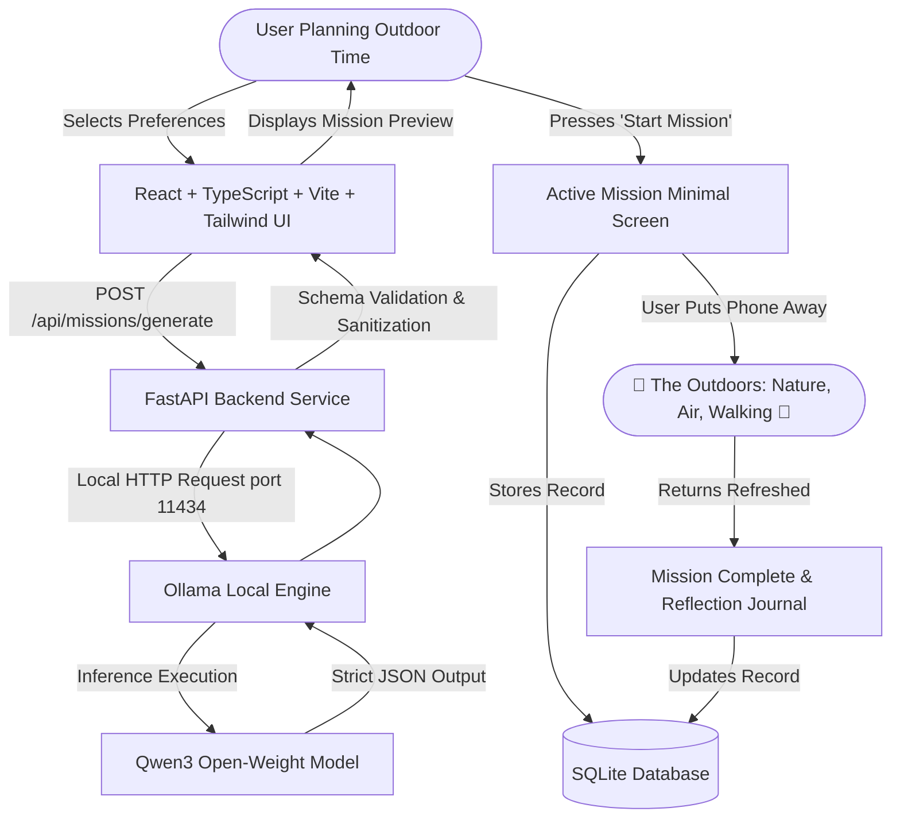

# TrailBuddy — Your Offline Outdoor Companion 🌿

> **"Use your screen to plan. Then put it away and go outside."**

TrailBuddy is an open-source, AI-powered outdoor activity companion built specifically for the **Hacktoberfest Open-Source AI Challenge Week 1: "Touch Grass"**. 

Instead of trapping you in an endless chat loop or addictive digital feed, TrailBuddy harnesses the power of local open-weight AI (**Qwen3** via **Ollama**) to generate realistic, mindful, screen-free outdoor adventures tailored to your available time, mood, and surroundings. Once your adventure begins, the application intentionally becomes minimal—providing only a quiet countdown timer and observation prompts—actively encouraging you to tuck your phone in your pocket and step into the physical world.

---

## Why TrailBuddy? (The "Touch Grass" Problem)

Modern consumer technology is engineered around digital retention: infinite scrolling feeds, notifications, and artificial chat personalities designed to keep eyes glued to glass screens.

The Hacktoberfest Week 1 challenge posed an urgent prompt:
> *"Build something with open-weight models or open-source AI that gets people off the screen and into the world."*

TrailBuddy solves this by turning digital planning into physical action:
- **Zero Chatbot Fluff**: Generates structured outdoor missions, not endless conversational paragraphs.
- **Screen-Free by Design**: The UI intentionally collapses to a minimalist countdown once your mission starts.
- **Physical Sensory Focus**: Tasks guide you to touch tree bark, notice wind direction, listen for ambient bird calls, and observe local geometry.
- **Complete Privacy & Offline Freedom**: Runs 100% on your machine using local open weights. No tracking, no cloud telemetry, and zero subscription gates.

---

## Architecture Diagram



---

## Key Features

- **Personalized Mission Generation**: Tailored to duration (15m to 2+ hours), activity (walking, hiking, nature exploration, photography, mindful outdoor time), mood, difficulty, and interests.
- **Powered by Local Qwen3**: Uses an open-weight foundation model via Ollama for local, zero-leak outdoor mission synthesis.
- **Strict Safety & Awareness Guardrails**: Enforces realistic pacing, zero trespassing, no interaction with hazardous wildlife, and continuous traffic/weather vigilance.
- **Minimalist Active Mission Timer**: Large, clean countdown with pause/resume, sequential observation challenge cards, and a prominent reminder to put your phone away.
- **Session Durability**: Active sessions and countdown progress persist in `localStorage` across page refreshes or device sleep.
- **Reflection Journaling & SQLite Archive**: Record how you felt (*Great*, *Energizing*, *Relaxing*) and what you noticed (*scent of wet pines, wind shifts*) directly to a local SQLite database.
- **Developer Mock Mode**: Built-in `MOCK_AI=true` fallback mode for instant development and test automation without requiring GPU/Ollama.

---

## Technology Stack

- **Frontend**: React 18, TypeScript, Vite, Tailwind CSS, Lucide React icons, React Router DOM.
- **Backend**: Python 3.10+, FastAPI, Pydantic v2, SQLAlchemy, Uvicorn, HTTPX.
- **Local AI / LLM**: Ollama with the open-weight `qwen3` model (or configurable to any open-weight model).
- **Storage**: SQLite (`trailbuddy.db`).
- **Testing**: `pytest`, `pytest-asyncio`, FastAPI `TestClient`.

---

## Requirements

Before running the application, make sure you have installed:
1. **Node.js** (v18 or newer) & **npm**
2. **Python** (v3.10 or newer)
3. **Ollama** ([Download Ollama](https://ollama.com/))
4. **Qwen3 Model** (or any supported open-weight model)

---

## Installation & Setup (Windows Guide)

### 1. Clone the Repository
```powershell
git clone https://github.com/AyushDinda/TrailBuddy.git
cd TrailBuddy
```

### 2. Set Up Local AI with Ollama
Open PowerShell and pull the open-weight Qwen3 model:
```powershell
ollama pull qwen3
ollama serve
```
*(By default, Ollama listens on `http://localhost:11434`)*.

### 3. Set Up the FastAPI Backend
In a new PowerShell terminal:
```powershell
# Create Python virtual environment
python -m venv .venv

# Activate virtual environment on Windows
.venv\Scripts\activate

# Upgrade pip and install dependencies
pip install -r backend\requirements.txt

# (Optional) Copy environment file
Copy-Item .env.example .env

# Run FastAPI backend with Uvicorn
uvicorn backend.main:app --reload --port 8000
```
*The backend API documentation is now live at: `http://localhost:8000/docs`*

### 4. Set Up the React Frontend
In another PowerShell terminal:
```powershell
cd frontend

# Install npm dependencies
npm install

# Start Vite development server
npm run dev
```
*Open your browser and visit: `http://localhost:5173`*

---

## Environment Variables

Configure your backend by creating a `.env` file in the project root:

| Variable | Default Value | Description |
|---|---|---|
| `OLLAMA_BASE_URL` | `http://localhost:11434` | Endpoint where Ollama daemon is running |
| `OLLAMA_MODEL` | `qwen3` | Configured open-weight model name |
| `FRONTEND_ORIGIN` | `http://localhost:5173` | Allowed CORS origin for Vite dev server |
| `DATABASE_URL` | `sqlite:///./trailbuddy.db` | Path to SQLite database file |
| `MOCK_AI` | `false` | When `true`, uses deterministic mock missions (useful if Ollama is not installed) |
| `OLLAMA_TIMEOUT_SECONDS` | `60.0` | Timeout threshold for Ollama inference requests |

---

## API Endpoints

| Method | Endpoint | Description |
|---|---|---|
| `GET` | `/api/health` | Returns backend health, AI model name, and mode status |
| `POST` | `/api/missions/generate` | Generates a structured outdoor mission via local Qwen3 model |
| `POST` | `/api/missions` | Saves a mission to SQLite database |
| `GET` | `/api/missions` | Retrieves all past missions (newest first) |
| `GET` | `/api/missions/{id}` | Retrieves a single mission record by ID |
| `PATCH` | `/api/missions/{id}/complete` | Records mission completion, feelings, and reflection notes |
| `DELETE` | `/api/missions/{id}` | Deletes a mission record from database |

---

## Running Automated Tests

Run backend integration and unit tests with `pytest`:
```powershell
.venv\Scripts\pytest backend\tests -v
```

Validate frontend production build and TypeScript compilation:
```powershell
cd frontend
npm run build
```

---

## Hacktoberfest 2026: "Touch Grass" Alignment

TrailBuddy directly satisfies the criteria of the Hacktoberfest Open-Source AI Challenge:
1. **Open-Weight Foundation**: Uses Qwen3, an open-weight model with publicly available weights.
2. **Local Inference**: Relies entirely on Ollama running on `localhost`.
3. **No Commercial AI Subscriptions**: Completely free of proprietary closed cloud APIs (no OpenAI, Anthropic, or Gemini tokens required).
4. **Physical World Action**: The AI generates tangible outdoor exploration tasks (observing trees, tracking wind, exploring parks) rather than digital outputs.
5. **Screen-Free by Design**: The application actively instructs the user to leave the screen and collapses itself into a quiet pocket timer.
6. **Mental Well-being & Nature**: Fosters mindful connection with real surroundings, soil, and living flora.
7. **Absolute Privacy**: Zero telemetry, tracking cookies, or location data harvesting.
8. **Pluggable & Experimentation-Friendly**: Developers can swap models (e.g. `llama3.2`, `mistral`, `gemma2`) with a single environment variable change.

---

## Future Improvements

- Audio chime or optional vibration cue when the screen-free timer completes.
- Multi-day outdoor quest trails and nature seasonal guides.
- Printable pocket cards (paper slips) for true 100% phone-at-home excursions.

---

## License

This project is licensed under the [MIT License](LICENSE).
Built with ❤️ for outdoor enthusiasts and open-source AI developers.
